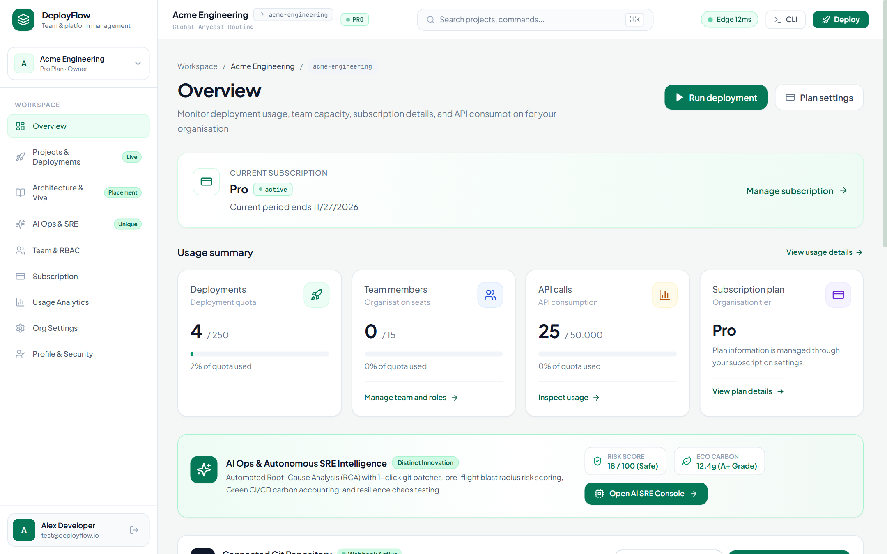
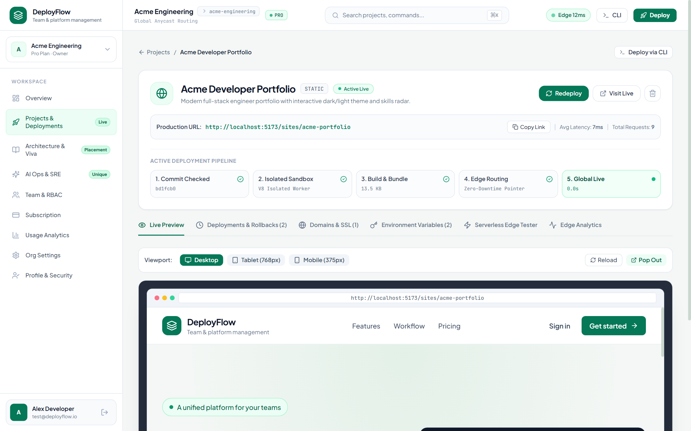
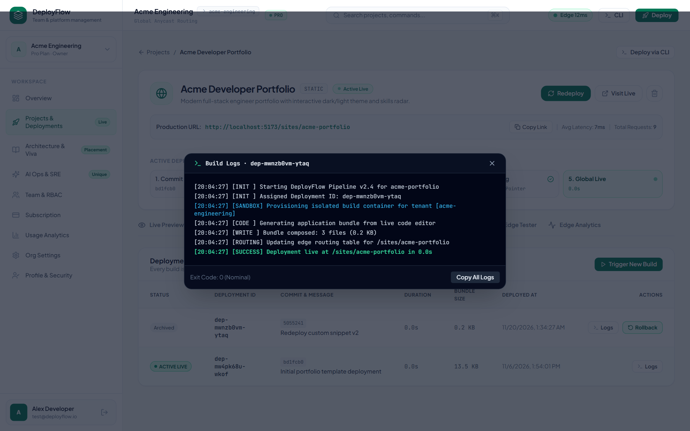
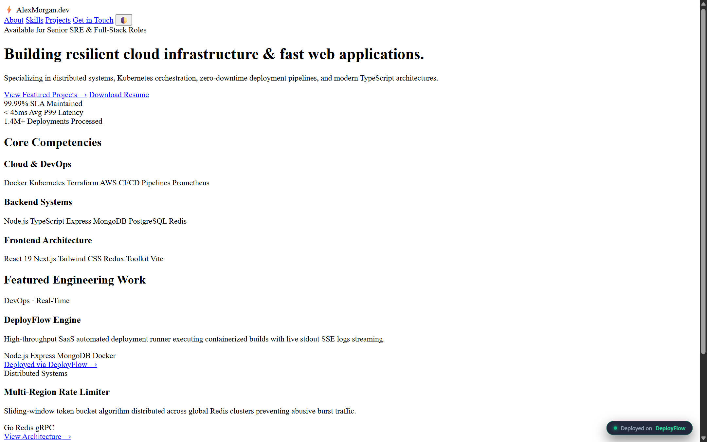
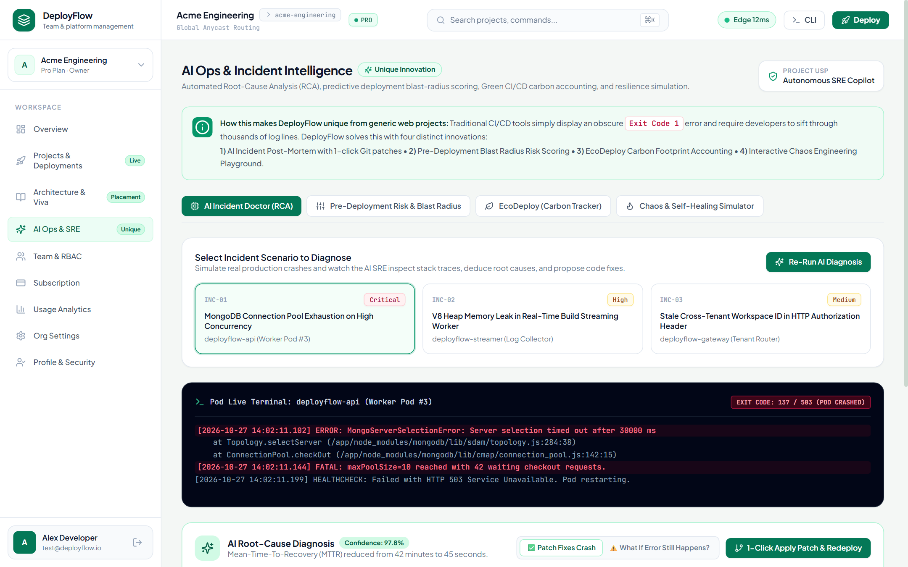

# DeployFlow

A full-stack, multi-tenant cloud deployment and edge application hosting platform built with React 19, TypeScript, Node.js, Express, and MongoDB. DeployFlow enables developers to compile, host, and serve static and SPA web applications with zero-downtime rollbacks, live build log streaming, and plan-based quota enforcement.

---

## Table of Contents
- [Problem Statement](#problem-statement)
- [System Architecture](#system-architecture)
- [Key Features](#key-features)
- [Technology Stack](#technology-stack)
- [Repository Structure](#repository-structure)
- [Getting Started](#getting-started)
  - [Prerequisites](#prerequisites)
  - [Local Development Setup](#local-development-setup)
  - [Docker Setup](#docker-setup)
- [Environment Variables](#environment-variables)
- [API Reference](#api-reference)
- [Testing](#testing)
- [CI/CD Pipeline](#cicd-pipeline)
- [Security Model](#security-model)
- [Screenshots & Visuals](#screenshots--visuals)
- [Future Enhancements](#future-enhancements)
- [License](#license)

---

## Problem Statement

Modern PaaS solutions often mask deployment operations behind proprietary abstractions. For engineers, understanding how source code transitions into an immutable, globally served web deployment is essential.

DeployFlow demonstrates this lifecycle end-to-end:
- Ingests user-submitted code (built-in templates, custom code snippets, ZIP archives, or Git repositories).
- Compiles artifacts into immutable, tenant-scoped storage.
- Routes live requests via an edge proxy with SPA fallback resolution.
- Executes sub-100ms zero-downtime rollbacks by swapping active directory targets.
- Tracks and enforces resource usage using concurrency-safe atomic token-bucket meters.

---

## System Architecture

```
                      +------------------------------------------+
                      |         Client Layer (React 19)          |
                      |  Dashboard | Terminal | Preview | Viva   |
                      +--------------------+---------------------+
                                           |
                              HTTP / SSE / Cookie Auth
                                           |
                                           v
                      +------------------------------------------+
                      |       Express API Gateway (Node 22)      |
                      |  Auth & RBAC | Project Routes | Probes   |
                      +----+-----------------+-------------------+
                           |                 |
            +--------------+                 +---------------+
            v                                                v
+-----------------------+                        +-----------------------+
|  Usage & Quota Engine |                        |   Deployment Engine   |
|  Atomic $inc Tracking |                        | Template / ZIP / Git  |
|  HTTP 429 Enforcement |                        | Live SSE Build Logs   |
+-----------+-----------+                        +-----------+-----------+
            |                                                |
            v                                                v
+-----------------------+                        +-----------------------+
|     MongoDB 7.0+      |                        |  Disk Storage System  |
| Multi-tenant Schemas  |                        | deployed_sites/<org>/ |
| Compound DB Indexes   |                        | <project>/current/    |
+-----------------------+                        +-----------+-----------+
                                                             |
                                                             v
                                                 +-----------------------+
                                                 |   Edge Proxy Server   |
                                                 | /sites/:projectSlug/* |
                                                 | SPA Fallback & Badging|
                                                 +-----------------------+
```

### Request Flow & Serving Mechanics
1. **Build Phase**: When a deployment triggers, `DeploymentEngine` assigns a unique deployment ID, provisions an isolated folder under `deployed_sites/<orgSlug>/<projectSlug>/<deploymentId>`, and compiles output files.
2. **Promotion Phase**: The engine synchronizes the active deployment into `deployed_sites/<orgSlug>/<projectSlug>/current/` and updates the active pointer in MongoDB.
3. **Serving Phase**: Requests hitting `/sites/:projectSlug/*` route through `siteServer.ts`. The proxy verifies quota availability, sanitizes paths against directory traversal, serves matching MIME types, and routes extensionless requests to `index.html`.
4. **Rollback Phase**: Instant rollback switches `current/` to point to a selected previous deployment folder, restoring previous builds immediately.

---

## Key Features

### 1. Ingestion & Build Engine
- **Multiple Vectors**: Ingests code via 5 built-in templates (Developer Portfolio, SaaS Landing, Dynamic Metrics, API Docs, E-Commerce Store), an in-dashboard code editor, ZIP archive upload, or Git repository cloning.
- **Directory Auto-Detection**: Automatically identifies and promotes nested build directories (`dist`, `build`, `public`).
- **Real-Time Build Logs**: Streams timestamped pipeline stages (`[INIT]`, `[SANDBOX]`, `[TEMPLATE]`, `[WRITE]`, `[ROUTING]`, `[SUCCESS]`) via Server-Sent Events (SSE).

### 2. Edge Routing & Application Serving
- **Zero-Downtime Serving**: Live web applications served directly from `/sites/:projectSlug`.
- **SPA Routing Support**: Automatically falls back to `index.html` for deep client routes.
- **Path Traversal Protection**: Resolves absolute file paths and enforces strict boundary containment checks.
- **Traffic Telemetry**: Tracks request counts, average response latencies, and HTTP status code breakdowns.

### 3. Multi-Tenancy & Access Control
- **Tenant Isolation**: MongoDB documents reference tenant `organisation` IDs; filesystem builds are segregated under tenant-specific namespaces.
- **Role-Based Access Control (RBAC)**: Supports `owner`, `admin`, and `member` roles with granular permission guards.
- **Invitation Flow**: Organization invitation system with automatic claim mechanisms on user registration.

### 4. Subscription & Quota Enforcement
- **Plan Tiers**: Free Starter, Professional, and Enterprise tiers with varying limits on deployments, team seats, API requests, and build minutes.
- **Atomic Metering**: Concurrency-safe token-bucket usage metering using MongoDB atomic operators.
- **Rate-Limit Handling**: Automatically serves informative HTTP 429 responses upon monthly quota exhaustion.

### 5. Developer Experience & Observability
- **Responsive Viewport Preview**: In-dashboard emulator switching between Desktop, Tablet (768px), and Mobile (375px).
- **Incident Recovery Simulator**: Built-in AI-Ops diagnostic console demonstrating root-cause analysis and configuration patch application.
- **Architecture Viva Portal**: Interactive system design and interview review guide explaining core architectural decisions.

---

## Technology Stack

| Domain | Technology | Purpose |
|---|---|---|
| **Frontend** | React 19, TypeScript 5.7, Vite 6 | High-performance developer interface and SPA |
| **State & Data** | Redux Toolkit, RTK Query | Cache management and asynchronous API orchestration |
| **Styling** | Tailwind CSS 3.4, Lucide Icons | Responsive modern interface design |
| **Backend** | Node.js 22 LTS, Express 4.21 | REST API gateway, SSE stream emitter, and edge proxy |
| **Database** | MongoDB 7.0+, Mongoose 8.9 | Schema modeling with compound indexing |
| **Validation** | Zod 3.24 | Runtime schema and payload validation |
| **Logging** | Pino 9.6, Pino-Pretty | Structured JSON logging with correlation IDs |
| **Containerization** | Docker, Docker Compose, Nginx Alpine | Multi-stage production container builds and reverse proxy |
| **Testing** | Jest 29, Supertest 7, Vitest 3 | Backend integration test suite and frontend unit tests |
| **CI/CD** | GitHub Actions | Automated type-checking, linting, and test execution |

---

## Repository Structure

```
deployflow/
├── .github/
│   └── workflows/
│       └── ci.yml               # Automated CI test and build workflow
├── client/                      # Frontend Single Page Application
│   ├── src/
│   │   ├── components/          # Reusable UI controls, modals, and navigation
│   │   ├── features/            # Redux store configuration and auth slices
│   │   ├── layouts/             # Public, Dashboard, and Admin route wrappers
│   │   ├── pages/               # Dashboard views, admin panels, and public pages
│   │   └── services/            # RTK Query API client endpoints
│   ├── package.json
│   └── vite.config.ts
├── docker/
│   ├── Dockerfile.client        # Multi-stage Nginx build for React client
│   ├── Dockerfile.server        # Production Node.js Alpine image (non-root)
│   └── nginx.conf               # Nginx reverse proxy with SPA fallback
├── server/                      # Backend API Gateway and Edge Server
│   ├── src/
│   │   ├── config/              # Database connection, plans, and environment
│   │   ├── controllers/         # Request handling logic across domains
│   │   ├── middleware/          # Authentication, RBAC, quota, and error handling
│   │   ├── models/              # Mongoose schemas (Project, Deployment, Org, etc.)
│   │   ├── routes/              # Express route declarations
│   │   ├── services/            # Deployment engine, site proxy, usage metering
│   │   └── utils/               # JWT token utilities, password hashing, logger
│   ├── tests/
│   │   └── api.test.ts          # Comprehensive integration test suite (23 tests)
│   └── package.json
├── docker-compose.yml           # Multi-container local production environment
├── dev-runner.mjs               # Development orchestrator with port conflict check
└── package.json                 # Workspace script orchestrator
```

---

## Getting Started

### Prerequisites
- **Node.js**: v20 or v22 LTS
- **npm**: v10+
- **MongoDB**: Community Server v7.0+ (running locally on port 27017 or accessible via URI)
- **Docker**: (Optional, for containerized execution)

---

### Local Development Setup

1. **Clone the repository**:
   ```bash
   git clone https://github.com/janvi-08/DeployFlow.git
   cd DeployFlow
   ```

2. **Install dependencies**:
   ```bash
   npm install --prefix server
   npm install --prefix client
   ```

3. **Configure environment variables**:
   Create a `.env` file inside the `server/` directory:
   ```bash
   cp .env.example server/.env
   ```

4. **Launch development servers**:
   Using the built-in development runner:
   ```bash
   npm run dev
   ```
   Or run client and server independently in separate terminals:
   ```bash
   # Terminal 1: Backend API (Port 5000)
   npm run dev:server

   # Terminal 2: Frontend Client (Port 5173)
   npm run dev:client
   ```

5. **Access the application**:
   - Web Client: `http://localhost:5173`
   - API Probes: `http://localhost:5000/healthz`

---

### Docker Setup

DeployFlow includes multi-stage production Docker configurations with an Nginx reverse proxy and dedicated MongoDB container.

1. **Start all services**:
   ```bash
   docker compose up --build
   ```

2. **Access services**:
   - Web Application & Proxied API: `http://localhost:80`
   - Direct Backend API: `http://localhost:5000`
   - MongoDB: Port `27017`

3. **Stop containers**:
   ```bash
   docker compose down
   ```

---

## Environment Variables

All sensitive values are parameterized. Configure the following keys in `server/.env`:

| Variable | Description | Default / Example Placeholder |
|---|---|---|
| `NODE_ENV` | Runtime environment mode | `development` |
| `PORT` | Backend server listener port | `5000` |
| `CLIENT_URL` | Allowed origin for CORS headers | `http://localhost:5173` |
| `MONGODB_URI` | MongoDB connection URI string | `mongodb://127.0.0.1:27017/deployflow` |
| `JWT_SECRET` | Secret key used to sign session tokens | `<your-secure-jwt-signing-key>` |
| `JWT_EXPIRES_IN` | Token duration | `7d` |
| `COOKIE_SECRET` | Secret key for signed cookies | `<your-secure-cookie-secret-key>` |
| `ADMIN_EMAIL` | Default system administrator email | `admin@deployflow.io` |
| `ADMIN_PASSWORD` | Default bootstrap admin password | `<your-secure-admin-password>` |
| `ADMIN_NAME` | Default administrator display name | `System Administrator` |
| `MAX_REQUESTS_PER_MINUTE` | Rate limit ceiling per IP address | `100` |

---

## API Reference

### Health & Liveness Probes
- `GET /healthz` — Process uptime and system health status.
- `GET /readyz` — Database connection readiness status.

### Edge Serving Engine
- `GET /sites/:projectSlug` — Serves the active deployment bundle for a project.
- `GET /sites/:projectSlug/*` — Resolves static assets with SPA route fallback.
- `GET /live/:deploymentId` — Serves immutable historical deployment previews.

### Authentication & Tenant Identity
- `POST /api/auth/register` — Creates user account and issues session cookie.
- `POST /api/auth/login` — Verifies credentials and sets `HttpOnly` token cookie.
- `POST /api/auth/logout` — Invalidates active session cookie.
- `GET /api/auth/me` — Fetches authenticated profile and associated memberships.

### Projects & Deployments
- `GET /api/projects` — Lists projects in the current workspace.
- `POST /api/projects` — Creates and initiates project deployment from source.
- `GET /api/projects/:id` — Retrieves project details, active deployment, and historical runs.
- `PATCH /api/projects/:id` — Updates project settings and environment variables.
- `DELETE /api/projects/:id` — Removes project record and cleans on-disk files.
- `POST /api/projects/:id/deploy` — Triggers new build via template, code, or upload.
- `POST /api/projects/:id/rollback/:deploymentId` — Performs sub-100ms atomic rollback.
- `GET /api/projects/:id/analytics` — Fetches edge traffic count, latency, and status metrics.
- `GET /api/projects/templates` — Catalog of pre-built deployment templates.
- `GET /api/projects/deployments/:deploymentId/logs-stream` — Real-time SSE build logs.

### Billing & Quota Management
- `GET /api/billing/plans` — Returns available plan tiers and quota thresholds.
- `GET /api/billing/subscription` — Retrieves active workspace plan and usage summary.
- `POST /api/billing/change-plan` — Updates plan tier and adjusts quota ceiling.

---

## Testing

DeployFlow maintains automated testing suites across both server and client applications.

### Backend Integration Tests (Jest & Supertest)
The backend suite executes 23 comprehensive integration tests verifying health probes, authentication lifecycles, RBAC authorization, quota enforcement, live application serving, directory traversal protection, and atomic rollbacks.

```bash
cd server
npm test
```

### Frontend Component Tests (Vitest & Testing Library)
Frontend unit tests validate UI component rendering, theme variants, and state reactivity:

```bash
cd client
npm test
```

### Static Type Checking & Code Quality
```bash
# Backend TypeScript verification
cd server && npx tsc --noEmit

# Frontend TypeScript verification
cd client && npx tsc -b
```

---

## CI/CD Pipeline

Continuous integration is managed via GitHub Actions (`.github/workflows/ci.yml`). Every pull request and push to `main`/`master` triggers parallel test workflows:

1. **`test-server` Job**:
   - Provisions a native `mongo:7.0` service container.
   - Sets up Node.js v22 runtime with npm dependency caching.
   - Executes `tsc --noEmit` to ensure type integrity.
   - Runs the Supertest integration suite against the live database container.

2. **`test-client` Job**:
   - Sets up Node.js v22 runtime.
   - Executes `tsc -b` and production Vite build bundle generation.
   - Runs the Vitest component test suite.

---

## Security Model

- **Directory Traversal Prevention**: Serving logic uses `path.resolve` combined with strict path boundary assertions (`targetFile.startsWith(siteDir)`), preventing arbitrary filesystem reads.
- **Cookie Security**: Session tokens are delivered via `HttpOnly`, `SameSite=Lax` cookies, neutralizing cross-site scripting (XSS) token exfiltration risks.
- **Tenant Isolation**: MongoDB queries enforce tenant partitioning; filesystem builds are segregated under tenant-specific namespaces.
- **Input Sanitization**: Request bodies are validated through strict Zod schemas before hitting business logic.
- **Container Hardening**: Backend Docker container runs as an unprivileged non-root user (`node`).
- **Data Protection**: Repository configuration excludes `.env`, `mongodb_data/`, and generated `deployed_sites/` from version control.

---

## Screenshots & Visuals

### 1. Dashboard Overview
Workspace health metrics, active workloads, quota consumption, and tenant navigation.


### 2. Live Application Preview & Viewport Emulator
Multi-device responsive viewport preview (Desktop, Tablet 768px, Mobile 375px) with real-time edge latency telemetry.


### 3. Real-Time SSE Build Logs & Terminal
Server-Sent Events streaming timestamped build pipeline phases directly to the developer terminal emulator.


### 4. Edge-Served Application & Live Branding
Real standalone web application served by the Express Edge Proxy at `/sites/:projectSlug` with injected floating DeployFlow badge.


### 5. AI-Ops Incident Simulator & Self-Healing
Interactive SRE incident triage simulator showing real log traces, root-cause diagnosis, and automated config patch generation.


---

## Limitations & Future Scope

### Architecture Limitations & Scoping
To maintain engineering transparency:
- **Process & Filesystem Isolation**: Build sandboxing is executed via Node.js processes and filesystem directories. It does not employ a multi-tenant Kubernetes worker cluster.
- **Edge Routing Simulation**: The edge proxy is an Express and Nginx gateway providing local and containerized route dispatch and SPA fallbacks, rather than a distributed Anycast CDN.
- **Simulated Billing State**: Subscription upgrades and quota refreshes operate on internal state machines without processing live credit cards or live Stripe webhooks.

### Future Enhancements
- **Object Storage Adapter**: S3/MinIO driver interface for storing deployment artifacts across distributed cloud object stores.
- **Dynamic Container Runners**: Ephemeral Docker worker pools for executing isolated untrusted build scripts.
- **Automated TLS Certificates**: Automated Let's Encrypt TLS certificate provisioning for custom domains.
- **Webhook Integrations**: GitHub/GitLab webhook receivers for automatic push-to-deploy Git triggers.

---

## License

This project is licensed under the MIT License — see the [LICENSE](LICENSE) file for details.
